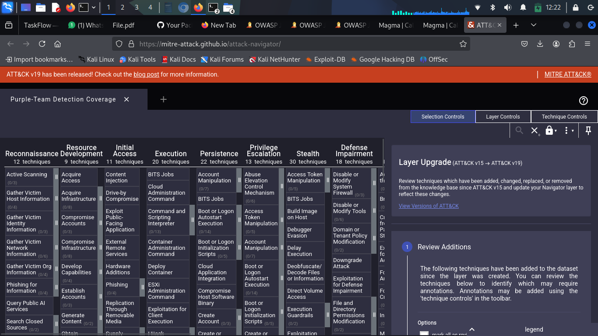
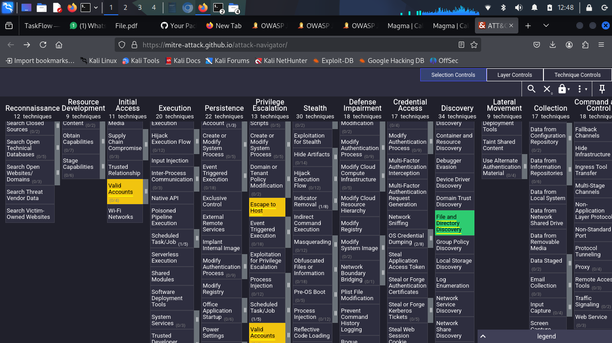

# Purple-Team Detection-as-Code

**A self-testing security platform that attacks itself on every Pull Request — and blocks the merge if a detection regresses.**

> *"If an attacker ran technique T1059.004 tomorrow, would we catch them?"*
> This repo answers that question automatically, in three minutes, on every PR.

Built over 8 weeks as Project 3 of the **DevOps Advance** portfolio.

---

## The Headline — Coverage Before vs After

The MITRE ATT&CK matrix below shows what we detect. Green = rule exists **and** CI proves it fires. Yellow = rule exists, untested. Gray = no rule.

### Before Week 7
*5 verified detections, 12 untested rules.*



### After Week 7
*15 verified detections, 7 untested rules — three times more proven coverage in one week, and one false-positive caught before it could ever ship to production.*



---

## Impact Metrics

| Metric | Final |
|--------|------:|
| Sigma source rules | **20** |
| Falco runtime rules (production) | **20** |
| MITRE ATT&CK techniques covered | **22** |
| Of those, **CI-verified firing on real attacks** | **15** |
| SIEM dialects each rule compiles to | **4** (Elastic EQL, Kibana Lucene, Splunk SPL, Grafana LogQL) |
| Rules per PR auto-compiled in CI | **80** (20 source × 4 backends) |
| Production-relevant false positive caught by CI | **1** (T1053.003 firing on host-level dockerd) |
| Average CI time per PR | ~3 min (purple-team) + ~50s (compile gate) |

---

## What This Repo Actually Is

A **purple-team CI pipeline** with three reinforcing pieces:

1. **Detection rules** (`rules/` — Sigma + `falco/custom-rules/` — Falco) — alarms that catch specific attacker techniques.
2. **Compilation pipeline** (`scripts/compile.sh`) — translates each Sigma rule to four SIEM dialects, validated on every PR by `.github/workflows/rules-ci.yml`.
3. **Live attack-and-detect gate** (`.github/workflows/purple-team.yml`) — spins up Falco on a fresh GitHub runner, runs a scripted attack burst inside a Docker container, and **fails the build** if any expected rule didn't fire or any unexpected one did.

The core insight: **untested rules are more dangerous than no rule at all** (you *think* you're protected). This project moves rules from "we have it" to "CI proves it works on every change."

---

## Architecture (One Picture)

```
                  Developer opens a PR
                          │
                          ▼
        ┌─────────────────────────────────────────┐
        │         GitHub Actions (free tier)      │
        ├─────────────────────────────────────────┤
        │                                          │
        │  ┌─ Workflow 1 ──────────────────┐      │
        │  │ Rules CI                      │      │
        │  │ ┌── pySigma ──────────┐       │      │
        │  │ │ rules/*.yml ─► dist/│       │      │
        │  │ │  ├ eql/             │       │      │
        │  │ │  ├ lucene/          │       │      │
        │  │ │  ├ splunk/          │       │      │
        │  │ │  └ loki/            │       │      │
        │  │ └─────────────────────┘       │      │
        │  │ ┌── falco -V ────────┐        │      │
        │  │ │ Lint Falco rules   │        │      │
        │  │ └────────────────────┘        │      │
        │  └───────────────────────────────┘      │
        │                                          │
        │  ┌─ Workflow 2 ──────────────────┐      │
        │  │ Purple Team                   │      │
        │  │ ┌── Falco on host ─────────┐  │      │
        │  │ │ modern_ebpf, our rules,  │  │      │
        │  │ │ rule_matching=all        │  │      │
        │  │ └────────────┬─────────────┘  │      │
        │  │              ▼                │      │
        │  │ ┌── docker run ubuntu ─────┐ │      │
        │  │ │ scripted attack burst    │ │      │
        │  │ │ (whoami, cat /etc/shadow,│ │      │
        │  │ │  find id_rsa, base64|sh, │ │      │
        │  │ │  ifconfig, useradd ...)  │ │      │
        │  │ └────────────┬─────────────┘ │      │
        │  │              ▼                │      │
        │  │ ┌── jq + bash assertion ───┐ │      │
        │  │ │ EXPECTED set fired? ✅/❌│ │      │
        │  │ │ UNEXPECTED set silent?✅ │ │      │
        │  │ └────────────┬─────────────┘ │      │
        │  └──────────────┼────────────────┘     │
        │                 ▼                       │
        │  ┌─ Sticky PR comment ──────────┐      │
        │  │ Markdown coverage table      │      │
        │  └──────────────────────────────┘      │
        │                                          │
        └─────────────────────────────────────────┘
                          │
                  ┌───────┴────────┐
                  ▼                ▼
              ✅ merge          ❌ blocked
```

---

## The 8-Week Build

Each week's deep-dive document lives in [`docs/`](docs/).

| Week | Topic | Doc |
|------|-------|-----|
| 1 | Kubernetes cyber-range (kind cluster, NetworkPolicy isolation, Juice Shop target) | [WEEK1.md](docs/WEEK1.md) |
| 2 | MITRE Caldera + Sandcat agent + Atomic Red Team integration | [WEEK2.md](docs/WEEK2.md) |
| 3 | First 16 Sigma + Falco rules covering top Linux ATT&CK techniques | [WEEK3.md](docs/WEEK3.md) |
| 4 | Sigma → 4-backend compilation pipeline; live Falco DaemonSet via Helm | [WEEK4.md](docs/WEEK4.md) |
| 5 | GitHub Actions CI — compile gate + live attack-and-detect gate | [WEEK5.md](docs/WEEK5.md) |
| 6 | MITRE ATT&CK coverage heatmap (Navigator layer export) | [WEEK6.md](docs/WEEK6.md) |
| 7 | Gap analysis + 5 new rules + 5 yellow→green transitions | [WEEK7.md](docs/WEEK7.md) |
| 8 | Portfolio writeup (this README) | [WEEK8.md](docs/WEEK8.md) |

---

## How to Run It Locally

### Quickstart — two commands

```bash
./scripts/setup.sh    # one-time: installs Falco, jq, pySigma toolchain (uses sudo)
./scripts/demo.sh     # any time: compile + live attack & detect + heatmap export
```

`demo.sh` will:
1. Compile all 20 Sigma rules to 4 SIEM dialects (~10s)
2. Start Falco on the host, run the scripted attack burst inside an `ubuntu:22.04` container, assert all expected rules fired (~30s)
3. Export the MITRE ATT&CK coverage heatmap to `dist/attack-coverage.json`

It cleans up Falco on exit (trap), and is safe to re-run.

### Prerequisites
- Linux with Docker installed (tested on Kali 6.12 / Ubuntu 22.04+)
- Python 3.11+
- `sudo` access (Falco's eBPF probe needs root)

### Run the individual pieces (advanced)

```bash
# Just the compilation pipeline
./scripts/compile.sh

# Just the heatmap export (assumes rules/ already exists)
python3 scripts/export-attack-coverage.py

# Just the attack-and-assert (assumes Falco already running, log file env var set)
FALCO_LOG_FILE=/tmp/falco-demo.log ./scripts/ci-attack-and-assert.sh
```

### View the heatmap
After `demo.sh` finishes, upload `dist/attack-coverage.json` at https://mitre-attack.github.io/attack-navigator/ (Open Existing Layer → Upload from local) and press `E` to expand sub-techniques.

---

## Repository Layout

```
.
├── rules/                          ← 20 Sigma source rules (one per technique)
├── falco/
│   ├── custom-rules/               ← Hand-authored Falco runtime rules
│   ├── values.yaml                 ← Helm config for production cluster
│   └── values-ci.yaml              ← Helm overrides for CI (legacy ebpf etc)
├── scripts/
│   ├── compile.sh                  ← Sigma → 4 SIEM backends pipeline
│   ├── ci-attack-and-assert.sh     ← Attack runner + coverage assertion
│   └── export-attack-coverage.py   ← Heatmap JSON generator
├── apps/                           ← Vulnerable target manifests (Juice Shop)
├── cluster/                        ← Namespace, NetworkPolicy, ResourceQuota
├── caldera/                        ← MITRE Caldera docker-compose
├── Localstack/                     ← Local AWS sandbox for cloud-side rules
├── .github/workflows/
│   ├── rules-ci.yml                ← Workflow 1 — compile + lint gate
│   └── purple-team.yml             ← Workflow 2 — live attack & detect
├── docs/                           ← Per-week deep-dive writeups + screenshots
├── requirements.txt                ← Pinned pySigma toolchain
└── README.md                       ← This file
```

---

## What This Project Taught Me

Eight weeks of writing detection rules and watching them fail in CI taught me more than reading any SOC textbook. Three lessons stand out:

**1. Yellow is more dangerous than gray.** A rule you've written but never tested is *worse* than not having one — you'll *think* you're covered when you're not. The whole second half of the project (Weeks 5–7) is about turning yellow into green, because that's where the real value lives.

**2. CI gates find what code review can't.** The same rule lived through a week of manual smoke tests with no problems. The moment we expanded the CI attack burst, T1053.003 fired on the GHA host's `dockerd`. That's a production-flooding false positive a human reviewer would never have caught — the test environment found it first. The CI gate is the project, more than the rules themselves are.

**3. Production-mirroring CI is a vanity goal.** The first attempt at Week 5's purple-team workflow tried to reproduce production exactly: kind cluster + Helm Falco DaemonSet + kubectl exec. It failed for **eight straight runs** because of nested-container kernel restrictions. The redesign — Falco on the runner host, attacks in a `docker run` container — is structurally different from production, but tests the **same syscalls against the same rules**. CI doesn't have to *be* production; it has to *exercise the rule logic* production runs. That distinction took half a day to internalize and is the single biggest CI lesson here.

---

## License

MIT — use anything in this repo for your own purple-team work.

## Author

**Suliman Khalid Noor** — built as part of the DevOps Advance / DevSecOps engineering portfolio. The full per-week build journey (with all the dead ends, eight CI iterations, and false starts left in) is in [`docs/WEEK1.md`](docs/WEEK1.md) through [`docs/WEEK8.md`](docs/WEEK8.md).
